# Arquitetura do Sistema — DEAD BREATH

| Campo | Valor |
|---|---|
| Versão | 0.2 (DRAFT — Fase 0, revisado após DISC-006) |
| Status | Proposta, aguardando aprovação junto com a ADR-001 |
| Engine assumida | Godot 4.7.2 + GDScript tipado (ver [ENGINE_DECISION.md](ENGINE_DECISION.md)) |
| Responsável | Software Architect (revisão: Project Director) |

> Nada descrito aqui está implementado. Este documento define a estrutura que a Fase 1 deve construir.

---

## 1. Princípios

1. **Simulação separada da cena.** Regras de jogo vivem em classes puras (`RefCounted`) sem acesso à árvore de cena. Os nós apenas adaptam essas classes. As regras ficam testáveis em headless e determinísticas.
2. **Composição em vez de herança.** Jogador e inimigos são montados com componentes pequenos. Papéis ("interfaces") são componentes-filho, porque GDScript não tem interfaces.
3. **Mediador por entidade.** O `PlayerRoot` é o único script que conhece os componentes do jogador e executa o tick deles em ordem. Os componentes não se referenciam.
4. **Firewall de percepção.** A IA só sabe o que os sensores perceberam. `HeardNoise` não carrega dados reais da fonte.
5. **Um evento, dois consumidores.** Cada ruído relevante é um único `NoiseEvent`, que alimenta o que o jogador ouve e o que a IA ouve. Inclui a respiração do próprio jogador.
6. **Dados fora do código.** Parâmetros de balanceamento ficam em Resources `.tres`.
7. **Fisiologia sem barra única.** Respiração, estresse e resistência são modelos independentes, com acoplamento explícito.
8. **Ordem de atualização determinística** (§6).
9. **Sem god-objects.** Autoloads só para serviços realmente globais, que não conhecem tipos de jogo.

## 2. Camadas

```
L4  Conteúdo        níveis, props, materiais, áudio, Resources .tres
L3  Apresentação    áudio, câmera e efeitos, UI, VFX
L2  Componentes     Nodes que adaptam L1 à cena
L1  Simulação       classes puras e tipos de dados de jogo
L0  Núcleo          autoloads genéricos (Log, EventBus, Settings, SaveService, GameState) e core/ (Enums, utilitários)
```

**Regras de dependência (verificadas pelo teste ARC-05)**
- Cada componente pertence a **uma** camada.
- Uma camada só depende de camadas abaixo. Dependência lateral só dentro de L2, via grupos ou injeção, nunca por caminho absoluto.
- L0 só usa tipos nativos do Godot e `core/`.
- L1 nunca referencia `Node`, `SceneTree` ou autoloads.
- L3 observa por sinais e nunca altera estado de jogo. Exceção: UI envia comandos do jogador.

## 3. Mapa de módulos

```mermaid
graph TD
  subgraph L0[L0 Núcleo]
    Log; EventBus; Settings; SaveService; GameState; Enums[core/Enums]
  end
  subgraph L1[L1 Simulação]
    Phys[Stamina / Stress / Respiratory / Coupling]
    Breath[BreathParams]
    Acoustic[AcousticGraph]
    Brain[EnemyBrain + PerceptionMemory]
    Squad[SquadCoordinator]
    InvModel[InventoryModel]
    ObjGraph[ObjectiveGraph]
    Diff[DifficultyModel]
    Snap[SnapshotSchema]
  end
  subgraph L2[L2 Componentes]
    Root[PlayerRoot]
    Motor[PlayerMotor]; PhysComp[PhysiologyComponent]; Threat[PlayerThreatMonitor]
    BreathEm[BreathEmitter]; Hiding[HidingComponent]; Target[PerceivableTarget]
    Emitter[NoiseEmitter]; World[AcousticWorld]
    Enemy[EnemyController]; Vision[VisionSensor]; Hearing[HearingSensor]
    Checkpoint[CheckpointManager]; Inventory; Objectives[ObjectiveManager]; Difficulty[DifficultyManager]
  end
  subgraph L3[L3 Apresentação]
    BreathAudio[BreathingAudio]; Router[NoiseAudioRouter]; Music[AdaptiveMusic]; CamFX[CameraEffects]; HUD
  end

  Root --> Motor
  Root --> PhysComp
  Root --> Threat
  Root --> BreathEm
  Root --> Hiding
  PhysComp --> Phys
  BreathEm --> Breath
  BreathEm --> World
  Emitter --> World
  World --> Acoustic
  World -- HeardNoise --> Hearing
  Enemy --> Vision
  Enemy --> Hearing
  Vision -- só PerceivableTarget --> Target
  Enemy --> Brain
  Enemy --> Squad
  World -- PlayerHeardNoise --> Threat
  Inventory --> InvModel
  Objectives --> ObjGraph
  Difficulty --> Diff
  Checkpoint --> Snap
  Checkpoint --> SaveService
  World -. noise_resolved_for_player .-> BreathAudio
  World -. noise_resolved_for_player .-> Router
  Threat -. threat_changed .-> Music
  PhysComp -. sinais .-> CamFX
```



| Módulo | Camada | Responsável | Documento de sistema |
|---|---|---|---|
| Log, EventBus, Settings, SaveService, GameState, Enums | L0 | Software Architect | este documento + COMPONENT_CONTRACTS §15 |
| PlayerRoot, PlayerMotor, InteractionComponent, Door, Pickup | L2 | Gameplay Engineer | Gameplay/PLAYER_CONTROLLER.md |
| Modelos fisiológicos, BreathParams | L1 | Physiological Systems Engineer | RESPIRATORY / STRESS / STAMINA_SYSTEM.md |
| PhysiologyComponent, PlayerThreatMonitor, StubThreatSource | L2 | Physiological Systems Engineer | idem |
| BreathEmitter | L2 | Physiological Systems Engineer + Audio Engineer | RESPIRATORY_SYSTEM.md, AUDIO_DESIGN.md |
| AcousticGraph | L1 | AI Engineer + Audio Engineer | Gameplay/STEALTH_SYSTEM.md |
| AcousticWorld, NoiseEmitter, RoomVolume, Portal (`components/acoustics/`) | L2 | AI Engineer + Audio Engineer | Gameplay/STEALTH_SYSTEM.md |
| EnemyBrain, PerceptionMemory, SquadCoordinator, DifficultyModel | L1 | AI Engineer | Gameplay/ENEMY_AI.md |
| EnemyController, EnemyWorldQuery, EnemyCaptureArea, Squad, VisionSensor, HearingSensor, PerceivableTarget, LightExposureProbe, DifficultyManager | L2 | AI Engineer | Gameplay/ENEMY_AI.md |
| Hideable, HidingComponent | L2 | Gameplay Engineer (contrato com AI Engineer) | Gameplay/STEALTH_SYSTEM.md |
| InventoryModel, ObjectiveGraph | L1 | Gameplay Engineer | INVENTORY_SYSTEM.md |
| Inventory, ObjectiveManager | L2 | Gameplay Engineer | INVENTORY_SYSTEM.md |
| SnapshotSchema | L1 | Software Architect | Gameplay/CHECKPOINT_SYSTEM.md |
| CheckpointManager | L2 | Software Architect | Gameplay/CHECKPOINT_SYSTEM.md |
| BreathingAudio, NoiseAudioRouter, AdaptiveMusic | L3 | Audio Engineer | Design/AUDIO_DESIGN.md |
| CameraEffects, HUD, menus, legendas, acessibilidade | L3 | Gameplay Engineer | (Fase 7) |

## 4. Padrões de comunicação

| Padrão | Uso | Exemplo |
|---|---|---|
| Mediador (PlayerRoot) | Troca de dados por frame entre componentes do jogador | exertion → fisiologia → limites do motor |
| Chamada direta (para baixo) | Componente usa seu modelo L1 ou um serviço L0 | `PhysiologyComponent` → `RespiratoryModel.tick()` |
| Sinal local | Componente avisa a apresentação ou o mediador | `respiratory_state_changed` → `CameraEffects` |
| AcousticWorld | Todo ruído com relevância de gameplay | `AcousticWorld.emit_noise(event)` |
| EventBus | Eventos transversais e esporádicos, com payload nativo | `player_captured`, `checkpoint_reached` |

**Proibido:** EventBus para dados por frame; `get_node()` com caminho absoluto entre sistemas; acessar autoload a partir de L1; L3 assinar estado real de inimigos.

## 5. Firewall de percepção (ADR-003)

- O único caminho de informação jogador → IA é `VisionSensor.evaluate(PerceivableTarget)` e `HearingSensor.receive(HeardNoise)`.
- `PerceivableTarget` é um **componente-filho** do jogador (grupo `perceivable`), com pontos de amostragem, exposição à luz, fator de postura e ocultação.
- `HeardNoise` contém apenas categoria, nível percebido, posição **estimada** (com erro e enviesada para o portal de entrada), confiança e timestamp. `NoiseEvent` nunca sai do AcousticWorld para a IA.
- `BrainWorldQuery` não tem método que retorne dado do jogador.
- O `SquadCoordinator` só transmite o que algum inimigo percebeu, com latência e fala audível.
- `DifficultyManager` e `PlayerThreatMonitor` nunca fornecem dados à IA.

**Verificação em duas camadas:**
1. **Estática (ARC-01):** scripts em `sim/ai/`, `sim/difficulty/`, `components/enemy/` e `components/perception/` (exceto `vision_sensor.gd`) não podem conter referências a `PlayerRoot`, `PlayerMotor`, `PhysiologyComponent`, `PlayerThreatMonitor`, `PlayerHeardNoise`, `NoiseEvent`, ao grupo `"player"` nem a caminhos de nó contendo `Player`. A fala dos inimigos sai por um `NoiseEmitter` filho (`components/acoustics/`), sem construir `NoiseEvent`. Os campos de `HeardNoise` e `PlayerHeardNoise` são validados por reflexão contra listas permitidas.
2. **Comportamental (AI-06):** duas execuções com o mesmo estado de RNG e o jogador em posições diferentes, ambas fora da percepção, produzem `EnemyIntent` **idênticos** em todos os ticks. A varredura estática sozinha não prova o firewall.

## 6. Ordem de atualização por frame de física (ADR-009)

Física a 60 Hz. `process_physics_priority`: valores menores rodam antes.

| Ordem | Prioridade | Etapa |
|---|---|---|
| 1 | -90 | `PlayerRoot`: motor (amostra input e move) → ameaça percebida → fisiologia → limites → BreathEmitter |
| 2 | -80 | Interações e mundo disparados pelo jogador (portas, pickups); emitem ruído |
| 3 | -60 | `AcousticWorld`: processa a fila de ruídos, propaga e entrega `HeardNoise` aos `HearingSensor` e `PlayerHeardNoise` ao `PlayerThreatMonitor` |
| 4 | -50 | Nó `Squad` (`SquadCoordinator`): libera mensagens cujo `deliver_at` venceu |
| 5 | -40 | `EnemyController`: percepts (visão, audição, esquadrão) → `EnemyBrain` → intenção → navegação; fala via `NoiseEmitter` filho |
| 6 | -30 | `EnemyCaptureArea`: sobreposição com o jogador + estado CHASE → `player_caught` → `EventBus.player_captured` |
| 7 | 0 | Props físicos, luzes e roteiro de nível |
| — | `_process` | Apresentação (áudio, câmera, UI) |

- O input é amostrado em `PlayerMotor.step()` (`Input.is_action_pressed`). O movimento do mouse é acumulado em `_unhandled_input` e consumido no step.
- Ruídos emitidos depois da etapa 3 (por exemplo, por props na prioridade 0 ou pela fala de inimigos na etapa 5) são propagados no tick seguinte. Latência máxima: 1 tick (≈ 16,7 ms).
- O `PlayerThreatMonitor.sample()` é lido na etapa 1 e usa os `PlayerHeardNoise` entregues na etapa 3 do tick **anterior**: latência de 1 tick para a reação do estresse ao som. Isso é imperceptível e aceito.

## 7. Modelo acústico (ADR-004)

- Grafo de **salas e portais** construído a partir dos nós `RoomVolume` e `Portal` do nível.
- Perda por distância `20·log10(max(d,1)) + 0.1·d`. Portais: aberto 3 dB, fechado 18 dB. Parede 25 dB, piso 30 dB. Prevalece o melhor caminho (Dijkstra).
- Audibilidade com **piso de ruído ambiente** por sala (chuva) e offset climático (trovão), em DATA_STRUCTURES §2.3.
- A posição estimada parte do último portal do caminho, com erro proporcional à atenuação.
- Áudio: `AudioStreamPlayer3D` com **atenuação nativa desligada**. O `NoiseAudioRouter` define `volume_db` a partir do `PropagationResult` e usa só o *panning* espacial e o reverb da sala. Assim o que o jogador ouve e o que a IA ouve não divergem (teste NOI-04).

## 8. Persistência e checkpoints (ADR-007)

- Entidades persistentes: grupo `saveable`, `persist_id` único por nível, `save_state()` / `load_state()`.
- O snapshot é completo: jogador, fisiologia (inclui `exertion_ema`), inventário, objetivos, mundo, `EnvironmentState`, pickups consumidos por ID e **estado de cada RNG** (como string).
- Inimigos voltam ao `EnemyInitialState` do checkpoint, não à posição do momento da captura.
- O `SaveService` (L0) faz I/O genérico com escrita atômica. O `CheckpointManager` (L2) monta e aplica o snapshot.

## 9. Configuração (ADR-006)

- Classes de configuração tipadas estendem `Resource`. As instâncias ficam em `game/content/data/*.tres`.
- Modelos L1 recebem a config no construtor. Testes criam configs sob medida.
- O overlay de debug ajusta valores em tempo real e exporta o `.tres` (ferramenta de balanceamento, F2-008).

## 10. IA (ADR-008)

FSM com 7 estados explícitos e perfis numéricos (`AIProfile`). Personalidades diferem por parâmetros e por pequenas especializações (o Leader distribui setores de busca). Estados complexos podem usar sub-FSM sem alterar o contrato.

## 11. Estrutura de diretórios (ADR-010)

```
DeadBreath/
├── README.md
├── Docs/
├── tools/                    scripts de build, testes e geração de assets
└── game/                     projeto Godot (project.godot)
    ├── autoload/             L0: log.gd, event_bus.gd, settings.gd, save_service.gd, game_state.gd
    ├── core/                 L0: enums.gd, utilitários sem dependência de jogo
    ├── sim/                  L1: physiology/, acoustics/, ai/, inventory/, objectives/, difficulty/, persistence/
    ├── components/           L2: player/, enemy/, perception/, acoustics/, interaction/, world/, persistence/
    ├── presentation/         L3: audio/, camera/, ui/, vfx/
    ├── content/              L4: levels/, props/, materials/, textures/, audio/, data/
    └── tests/                framework/, unit/, integration/, scenarios/, architecture/, run_all.gd
```

Convenções: `snake_case` para arquivos e pastas; `PascalCase` com `class_name` para classes; sinais no passado; constantes em `UPPER_SNAKE_CASE`; identificadores em inglês; documentação em pt-BR; chaves de texto traduzíveis (`prompt_key`, `name_key`) desde o início, o que é barato mesmo sem localização aprovada.

## 12. Arquitetura de testes

| Nível | Escopo | Execução |
|---|---|---|
| Unit | Classes L1 | Headless |
| Integration | Componentes L2 em cena mínima com frames simulados | Headless |
| Scenario | Bots com inputs roteirizados | Headless |
| Architecture | ARC-01 a ARC-06 (firewall, `persist_id`, L1 puro, parse, camadas, mediador) | Headless |
| Visual | Screenshot por script | **Com janela** (o modo headless não renderiza) |
| Performance | Frame time (média e p95), vsync desligado | Com janela |
| Playtest | Testes de experiência | Humano |

- Runner próprio `game/tests/run_all.gd` (sem plugins), com código de saída 0/1. Comando: `tools/run_tests.ps1`.
- O pipeline do ARC-04 roda `--headless --import` antes, para gerar o cache de `class_name`, e depois `--check-only` por arquivo, verificando o código de saída.
- Os warnings `untyped_declaration`, `unsafe_method_access` e `unsafe_property_access` são configurados como **erro**, o que pega chamadas a métodos inexistentes. O parse não substitui testes.

Detalhes: [TEST_PLAN.md](../QA/TEST_PLAN.md).

## 13. Orçamentos de desempenho (iniciais)

Alvo: 60 fps estáveis em 1080p na especificação mínima, a definir na F7.

| Sistema | Orçamento de CPU por frame |
|---|---|
| 3 inimigos (sensores + cérebro + navegação) | ≤ 1,0 ms |
| Propagação de um `NoiseEvent` (todos os ouvintes) | ≤ 0,2 ms |
| Fisiologia (tick completo) | ≤ 0,1 ms |
| Total de scripts de gameplay | ≤ 3,0 ms |

As medições começam na F4 (primeira cena com IA), e não só na F7.

## 14. Tratamento de erros

| Situação | Comportamento | Teste |
|---|---|---|
| `load_state` com campo ausente ou tipo errado | Usa o valor padrão do campo, registra `Log.warn(SAVE)` e continua | PER-08 |
| Snapshot com `schema_version` maior que o suportado | Recusa carregar, registra `Log.error` e mantém o checkpoint anterior | PER-08 |
| Snapshot com versão menor | Aplica migrações em sequência; sem migração disponível, recusa | PER-08 |
| JSON corrompido ou ausente | `SaveService.read_json` retorna `{}` com log; o jogo oferece reinício do capítulo | PER-08 |
| Falha de gravação | Escrita atômica (`.tmp` e depois renomeia); o arquivo anterior permanece válido; `Log.error` | PER-09 |
| `.tres` de config ausente | Falha imediata em build de debug (`assert`); em produção usa padrões do código e registra erro | ARC-07 |
| `persist_id` vazio ou duplicado | Falha no teste ARC-02; em runtime, `Log.error` e a entidade não é salva | ARC-02 |
| Erro interno em um modelo L1 | Nunca silencioso: `push_error` + `Log.error`, sem crash em produção | — |

## 15. Registros de decisão (ADRs)

| ADR | Decisão | Contexto | Alternativas rejeitadas | Consequências |
|---|---|---|---|---|
| 001 | Godot 4.7.2 + GDScript tipado | Desenvolvimento por agentes que escrevem texto | UE5, Unity 6, engine própria | Ver ENGINE_DECISION.md |
| 002 | Simulação pura (L1) separada da cena | Testes headless rápidos e determinísticos | Lógica direto nos Nodes | Mais classes adaptadoras; testes muito mais simples |
| 003 | Firewall de percepção (PerceivableTarget por composição, HeardNoise restrito) | Requisito: a IA não conhece posição não percebida | IA com acesso direto ao jogador "com regras" | Exige verificação estática e comportamental (ARC-01, AI-06) |
| 004 | Grafo de salas e portais; um NoiseEvent para áudio e IA; atenuação nativa desligada | Paredes e portas precisam afetar som de forma previsível e igual para jogador e IA | Raycasts livres; atenuação nativa do Godot | Level designer marca salas e portais; áudio depende do grafo |
| 005 | Mediador por entidade + sinais locais + EventBus só para eventos transversais | Evitar acoplamento circular e "sinal espaguete" | Componentes se assinando mutuamente | O PlayerRoot concentra a ordem do tick, mas não as regras |
| 006 | Config em Resources `.tres` | Balanceamento sem mexer em código | Constantes, JSON | Exige classes de config tipadas |
| 007 | Snapshots de `Saveable` com `persist_id` estável, pickups por ID e estado do RNG | Sem duplicação de itens e com reprodutibilidade | Save serializando a cena inteira | Toda entidade persistente precisa de id validado |
| 008 | FSM com perfis numéricos | 7 estados finitos, testabilidade | Behavior Trees, GOAP | Estados complexos usam sub-FSM |
| 009 | Ordem de tick por `process_physics_priority` | Determinismo e testes reprodutíveis | Ordem implícita da árvore | Tabela §6 precisa ser mantida |
| 010 | Projeto Godot em `game/`; L0 genérico | Docs e tools fora da importação; L0 sem tipos de jogo | `project.godot` na raiz | Caminhos de scripts começam em `game/` |

Todas com status **Proposta** até o gate F0.
